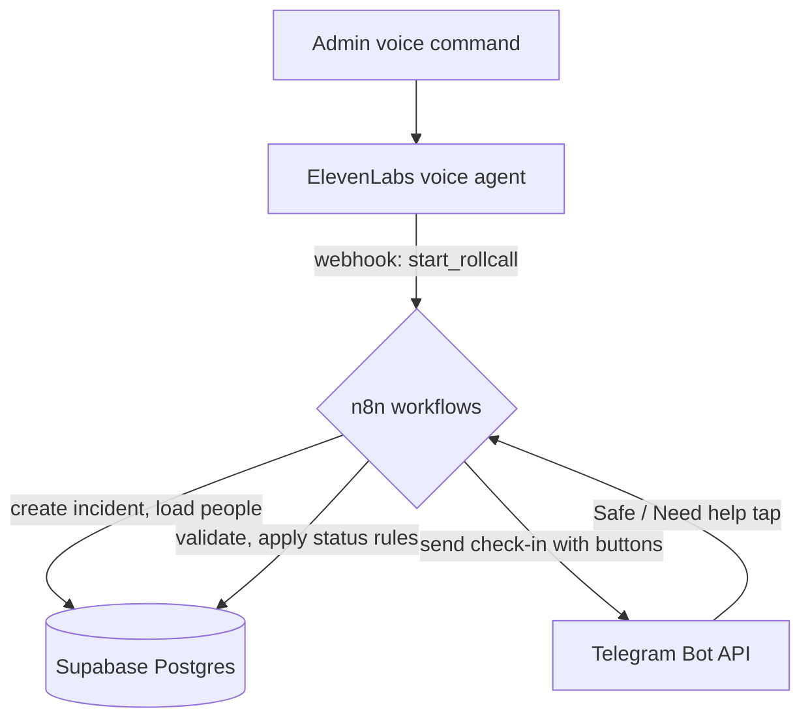
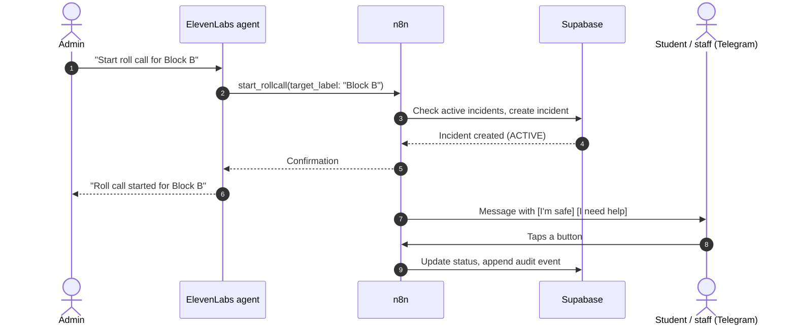

# Rollcall
 
**Voice-first emergency accountability for campuses.**
 
An administrator starts a roll call by voice. Rollcall creates an incident, sends personalized Telegram check-in messages with **I'm safe** / **I need help** buttons, records each response, and keeps an auditable timeline of everything that happened.
 
Built with ElevenLabs Conversational AI, n8n, Supabase, and Telegram.
 
> **Status: hackathon prototype (AI Summit Hackathon).**
> Uses synthetic demo data for campus safety drills. It is **not** a certified life-safety system and must not be relied on for real emergencies.
 
---
 
## The problem
 
In an emergency or drill, "who is safe?" is slow and unreliable:
 
- There is no fast, hands-free way for an administrator to start a check-in.
- Responses arrive through scattered chats, calls, and verbal reports.
- There is no reliable record of who responded, who needs help, and who is unaccounted for.
Rollcall turns a spoken command into a verified, auditable safety workflow.
 
---
 
## How it works
 
An admin says: **"Start roll call for Block B."**
 
1. **Voice:** the ElevenLabs agent extracts the intent and the block label.
2. **Validation:** an n8n webhook workflow checks the request, including whether an unresolved roll call is already active for that block.
3. **Incident:** n8n creates the incident in Supabase and sets everyone in the block to `PENDING`.
4. **Dispatch:** the Telegram bot sends each person a personalized message with **I'm safe** and **I need help** buttons.
5. **Response:** a button tap goes to a second n8n workflow, which validates the callback and applies the status rules.
6. **Record:** Supabase stores the new status and appends an event to the incident timeline.
### Architecture
 

 
### Sequence
 

 
---
 
## Safety design
 
**The AI proposes. n8n verifies. Supabase records.**
 
The ElevenLabs agent extracts only structured parameters:
 
- `intent`
- `target_label`
It never decides who a person is, which incident is active, what the final status is, or whether someone is safe. n8n resolves the real incident, person, and status transition.
 
### Status rules
 
| Situation | Result |
|---|---|
| A new roll call starts | Everyone is `PENDING` |
| Person taps **I'm safe** while `PENDING`, `UNCLEAR`, or `UNACCOUNTED` | Status becomes `SAFE` |
| Person taps **I need help** while `PENDING`, `UNCLEAR`, or `UNACCOUNTED` | Status becomes `NEED_ASSISTANCE` |
| Person taps **I'm safe** after `NEED_ASSISTANCE` | Status **stays** `NEED_ASSISTANCE` and `conflict = true` |
| Duplicate button press | Ignored: no duplicate update or alert |
| Second roll call for a block that already has an active one | Blocked |
 
### Data protection
 
- Supabase Row Level Security limits public access to read-only data.
- All writes happen through n8n's server-side credentials.
- Every action is appended to an event timeline (`ROLLCALL_STARTED`, `STATUS_UPDATED`, `ALERT_SENT`).
---
 
## What works today
 
Tested end to end during the hackathon:
 
- [x] ElevenLabs voice command: "Start roll call for Block B."
- [x] n8n production webhook trigger
- [x] Duplicate roll call protection
- [x] Incident creation in Supabase
- [x] Five personalized Telegram messages with inline buttons
- [x] Dynamic `safe:<incident_person_id>` and `help:<incident_person_id>` callbacks
- [x] Safe response: `PENDING` to `SAFE`
- [x] Need-help response: `PENDING` to `NEED_ASSISTANCE`
- [x] Duplicate response protection
- [x] Audit events: `ROLLCALL_STARTED`, `STATUS_UPDATED`, `ALERT_SENT`
## Known limitations
 
- No dashboard yet. The core safety loop runs through voice, n8n, Supabase, and Telegram only.
- Unanswered people stay `PENDING`. There is no automatic escalation yet.
- Telegram is the only response channel. People without Telegram are not reached.
- Demo data is synthetic and small (five people).
## Roadmap
 
- [ ] Automatic escalation for unanswered people
- [ ] Responder claim and resolution workflow
- [ ] Voice confirmations for status requests
- [ ] Live incident dashboard for command-center visibility
- [ ] Additional channels (SMS or call fallback)
- [ ] Multi-block drills and warden roles
---
 
## Tech stack
 
| Layer | Tool |
|---|---|
| Voice AI | ElevenLabs Conversational AI |
| Workflow automation | n8n |
| Database | Supabase (PostgreSQL, Row Level Security) |
| Messaging | Telegram Bot API |
 
---
 
## Repository structure
 
```text
Rollcall/
|-- docs/              # Architecture notes, test plan, demo script
|-- n8n-workflows/     # Exported n8n workflows (JSON)
|-- supabase/          # SQL schema and seed data
|-- .env.example       # Required environment variables (no secrets)
`-- README.md
```
 
## Setup
 
1. **Supabase:** create a project, then run the SQL in `supabase/` (schema first, then seed data).
2. **n8n:** import the workflows from `n8n-workflows/`, add your Supabase and Telegram credentials, and activate the workflows so the production webhooks are live.
3. **Telegram:** create a bot with [@BotFather](https://t.me/BotFather) and add its token to n8n. Each demo person must start a chat with the bot once.
4. **ElevenLabs:** create a Conversational AI agent with a `start_rollcall` webhook tool pointing at your n8n production webhook URL.
5. **Environment:** copy `.env.example` to `.env` and fill in the values.
> Never commit secrets. Keep the Supabase service-role key and Telegram bot token in n8n credentials or your local `.env` only.
 
## Demo script
 
1. Say: **"Start roll call for Block B."**
2. Show the Telegram messages arriving with **I'm safe** / **I need help** buttons.
3. Tap a button on a demo account.
4. Show the status change and the audit events in Supabase.
5. Tap the same button again to show duplicate protection.
- Voice commander: ElevenLabs agent "Rollcall Commander"
- Telegram bot: "Rollcall Demo"
---
